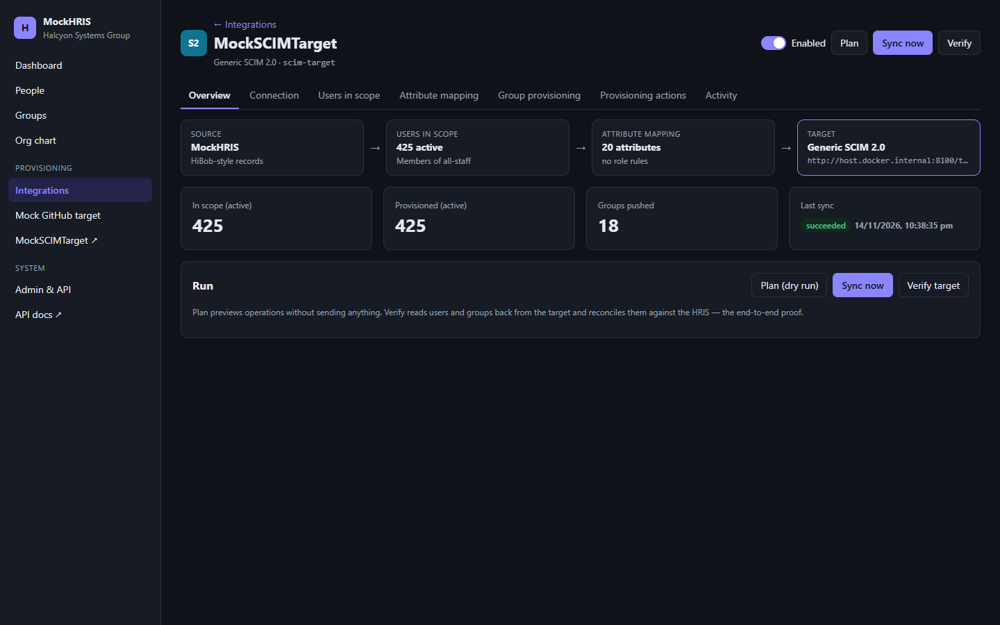
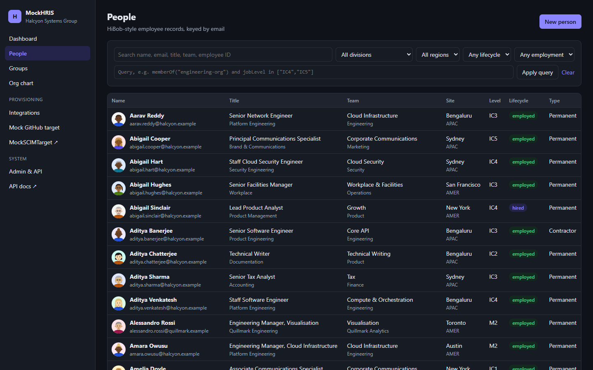
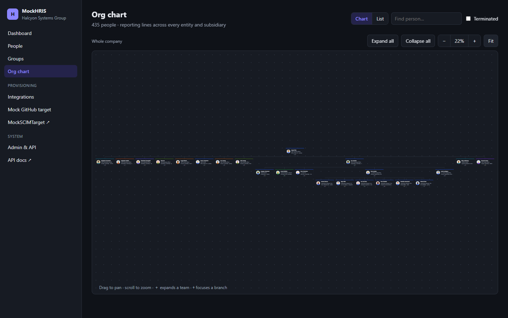
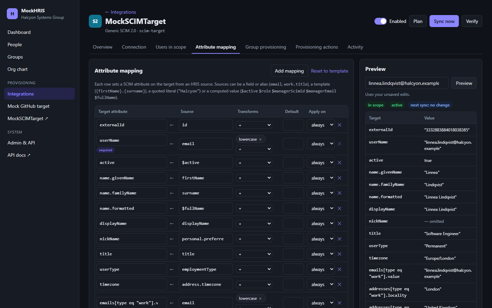
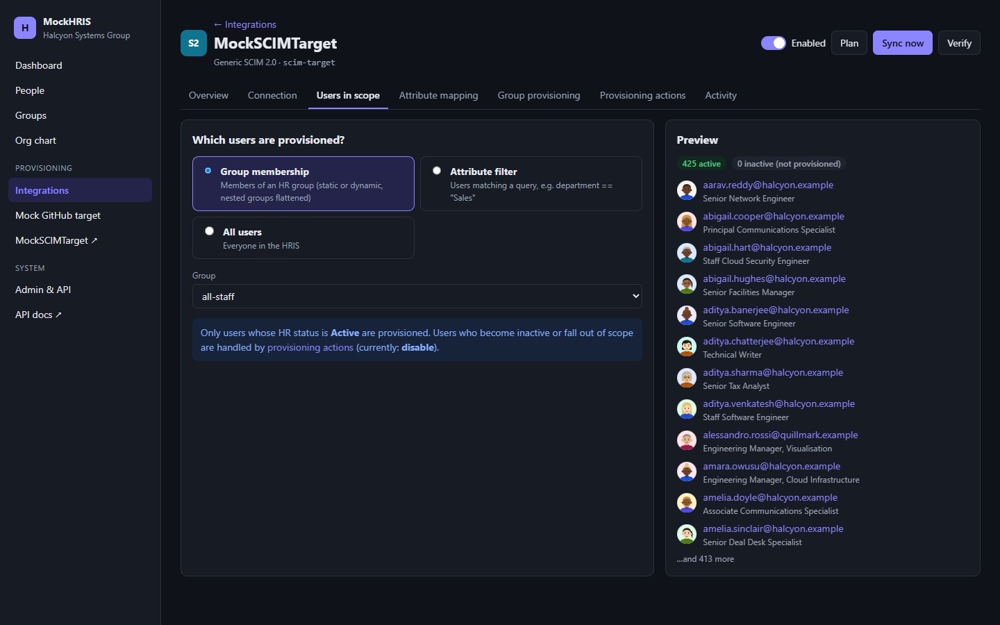
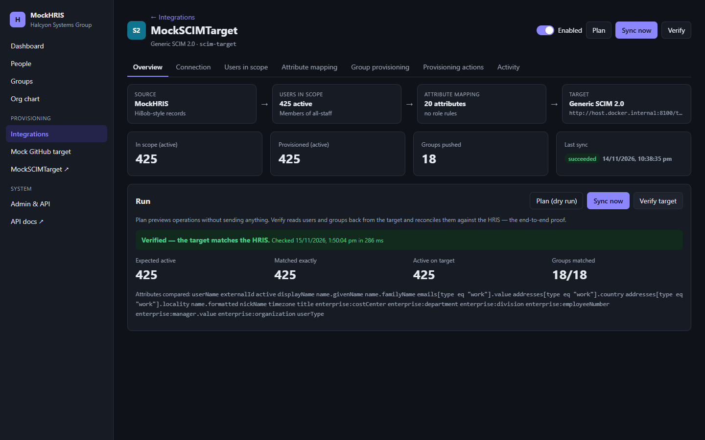
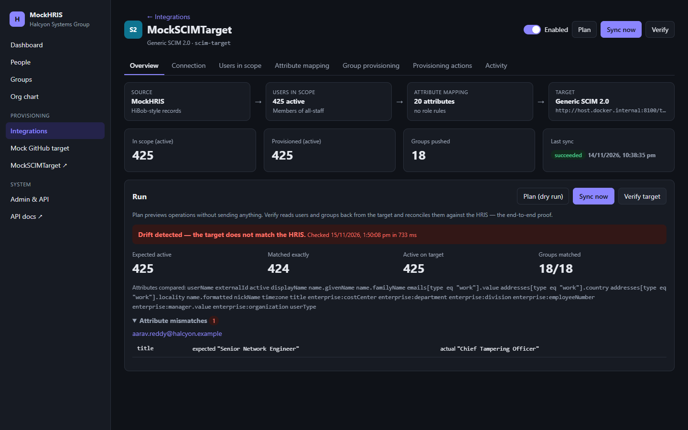
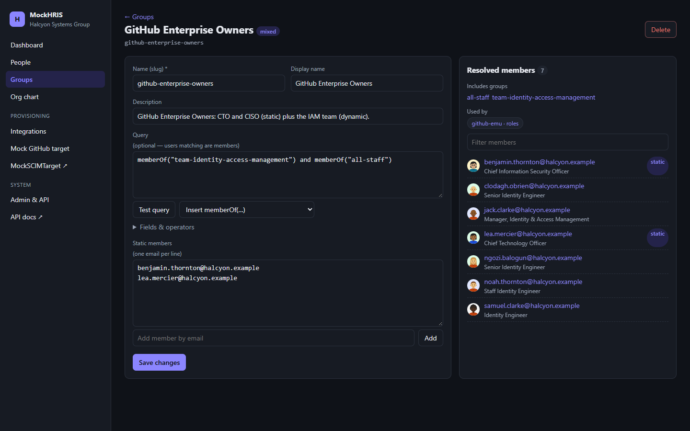
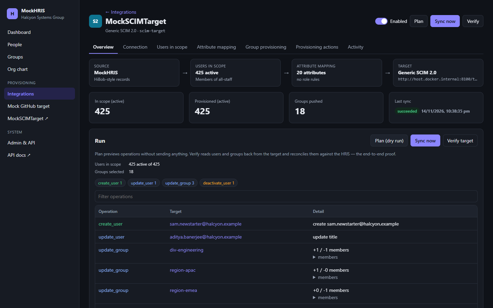

# scim-mock-hris

[](https://github.com/dddaaammmooo/scim-mock-hris/actions/workflows/tests.yml)
[](https://github.com/dddaaammmooo/scim-mock-hris/actions/workflows/security.yml)
[](https://github.com/dddaaammmooo/scim-mock-hris/actions/workflows/secret-scan.yml)
[](https://github.com/dddaaammmooo/scim-mock-hris/releases)


**MockHRIS** is a mock HR information system for building and testing **SCIM provisioning**,
especially to **GitHub Enterprise Managed Users (EMU)**. It gives you:

- **A realistic, fictitious company** to provision: ~440 people across 13 legal entities, three
  regions and three acquired subsidiaries. Each person has a full management chain and an
  avatar, in HiBob-style records.
- **Static and dynamic groups.** Dynamic groups are driven by a small query language, including
  groups of groups such as `memberOf("engineering-org") and region == "EMEA"`.
- **PingOne-style provisioning integrations.** Each one has a connection, users in scope,
  attribute mapping with transforms and a live preview, role rules, group push, and
  deprovisioning actions.
- **Verify:** an end-to-end reconciliation that reads the target back over SCIM and lists every
  difference from the HRIS.
- **Four interfaces over one service layer:** a web GUI, a REST API (OpenAPI at `/docs`), an
  MCP server for AI assistants, and a CLI.
- **DynamoDB Local storage,** running in a container.

It pairs with **[scim-target](https://github.com/dddaaammmooo/scim-target)**, a standalone
SCIM 2.0 server that receives what MockHRIS provisions, so you can prove the full lifecycle end
to end.



> **New here?** The **[user guide](docs/user-guide.md)** walks through every screen with screenshots, from
> exploring the company to setting up an integration, syncing, and verifying the result.

## Quick start

```bash
git clone https://github.com/dddaaammmooo/scim-mock-hris.git
git clone https://github.com/dddaaammmooo/scim-target.git
(cd scim-mock-hris && docker compose up -d --build)   # http://localhost:8000
(cd scim-target   && docker compose up -d --build)    # http://localhost:8100
```

1. Open http://localhost:8000. The company is generated on first start.
2. Go to **Integrations → MockSCIMTarget** and click **Sync now**. About 425 users and 18 groups
   are provisioned.
3. Click **Verify**. It should report *"Verified — the target matches the HRIS"*.
4. Terminate someone under **People** and click **Verify** again. The drift is reported. Then
   **Sync now** suspends them on the target.

There's also a built-in **GitHub EMU mock** at `/mock-github`, used by the `GitHub EMU`
integration. It lets you rehearse GitHub provisioning without a real enterprise. Point that
integration at `https://api.github.com/scim/v2/enterprises/<your-enterprise>` when you're ready.

| Service | URL |
|---|---|
| Web GUI | http://localhost:8000 |
| REST API docs (OpenAPI) | http://localhost:8000/docs |
| MCP endpoint (Streamable HTTP) | http://localhost:8000/mcp |
| Built-in GitHub EMU mock | http://localhost:8000/mock-github/scim/v2/enterprises/halcyon (token `mock-scim-token`) |
| DynamoDB Local | http://localhost:8001 |

Everything binds to `127.0.0.1`.

## Screenshots

| People | Org chart |
|---|---|
|  |  |
| **Attribute mapping with live preview** | **Users in scope** |
|  |  |
| **Verify: target matches the HRIS** | **Verify: drift detected** |
|  |  |
| **Group editor (static + query, nested groups)** | **Plan (dry run)** |
|  |  |

More screens are in the [user guide](docs/user-guide.md).

## Documentation

| Document | Contents |
|---|---|
| **[User guide](docs/user-guide.md)** | **Task-by-task walkthrough of every screen, with screenshots** |
| [Architecture](docs/architecture.md) | Components, request flow, storage tables, caching, design decisions |
| [Data model](docs/data-model.md) | The fictitious company, HiBob-style user records, derived fields, groups, avatars |
| [Query language](docs/query-language.md) | Dynamic groups and nested groups: grammar, operators, aliases, examples |
| [Provisioning integrations](docs/integrations.md) | Connection, scope, attribute mapping, transforms, roles, groups, actions, plan/sync/verify, GitHub EMU notes |
| [End-to-end testing](docs/end-to-end-testing.md) | Joiner, mover, leaver, rehire and drift scenarios with scim-target, and automating them |
| [REST API](docs/api.md) | Every endpoint, with examples |
| [MCP server](docs/mcp.md) | Connecting Claude or another MCP client; all 33 tools |
| [Configuration](docs/configuration.md) | Environment variables, tokens, networking, running against real AWS |
| [Deploy to AWS](docs/deploy-aws.md) | Terraform module for ECS Fargate + ALB + DynamoDB: architecture, steps, costs, security, teardown |
| [Development](docs/development.md) | Local setup, CLI, tests (100% backend coverage, Playwright UI tests), CI, code layout |

## Highlights

**Realistic source data.**
- The company has executive, engineering, security, IT, product, revenue, marketing, finance,
  legal and compliance, people and operations divisions, plus three subsidiaries with their own
  email domains.
- It includes the awkward cases a provisioner must handle: leavers, future starters, people on
  leave, contractors, interns, namesakes (`jane.doe2@`), and names with diacritics, apostrophes
  and spaces (`Ó Súilleabháin` becomes `o.suilleabhain@`).

**Groups as code.**
- A group can have static members, a query, or both.
- Queries can nest other groups with `memberOf(...)`.
- Cycles, unknown fields and unknown groups are rejected when you save, and nested groups are
  flattened because SCIM targets such as GitHub EMU can't nest groups.

**Mapping like an IdP.**
- Sources can be fields, templates (`{firstName}.{surname}`), literals, or computed values:
  `$active`, `$role`, `$managerScimId`, `$managerEmail`, `$fullName`.
- Ten transforms are available, such as `lowercase`, `localPart` and `asciiFold`.
- Defaults and "apply on create only" are supported.
- Targets can be any SCIM path, including `emails[type eq "work"].value` and enterprise URNs.

**Trustworthy syncs.**
- Every sync is computed from the HRIS and compared with stored state, so it's idempotent.
- Operations run in dependency order.
- When a create gets a 409, the existing resource is adopted, and 429s are retried.
- A follow-up pass in the same run fills manager references, so one sync converges.
- Verify compares **every mapped attribute** in both directions: HR changes not yet synced, and
  edits made directly on the target.

## Releases and container images

Releases are automated with [release-please](https://github.com/googleapis/release-please).
Commits to `main` follow [Conventional Commits](https://www.conventionalcommits.org/):
- `feat:` produces a minor release
- `fix:` produces a patch release
- `feat!:` or a `BREAKING CHANGE:` footer produces a major release

release-please keeps a release pull request open with the next version and the
`CHANGELOG.md` entry. Merging it tags the release, creates the GitHub release, and publishes
a multi-architecture image (`linux/amd64`, `linux/arm64`) to GitHub Packages. Each image
carries an SBOM and signed build provenance.

```bash
docker pull ghcr.io/dddaaammmooo/scim-mock-hris:latest      # or :1, :1.2, :1.2.3
docker run --rm -p 8000:8000 -e DYNAMODB_ENDPOINT=http://host.docker.internal:8001 \
  ghcr.io/dddaaammmooo/scim-mock-hris:latest          # needs DynamoDB Local, or use docker compose
```

To check an image's provenance: `gh attestation verify oci://ghcr.io/dddaaammmooo/scim-mock-hris:latest --owner dddaaammmooo`

## Security

See [SECURITY.md](SECURITY.md) for how to report a vulnerability. Every push and pull request
runs these checks:
- CodeQL for Python, JavaScript and GitHub Actions
- Bandit
- pip-audit
- Trivy, covering the container image and the Dockerfile/Terraform configuration
- Gitleaks secret scanning across the full history
- dependency review on pull requests

GitHub secret scanning with push protection, Dependabot alerts and security updates, and
Dependabot version updates are enabled on the repository. Version updates cover pip,
Actions, Docker and Terraform.

## Security note

This is a **test and demo tool**.
- The data is fictitious.
- The API and MCP endpoints are unauthenticated unless you set `MOCKHRIS_API_KEY`.
- Integration secrets are stored in DynamoDB Local, masked in every API response.

Keep it on localhost. When you connect it to a real GitHub enterprise, use a dedicated test
enterprise and pass the token through `INTEGRATION_TOKEN_<ID>`.
