# User guide

This guide walks through MockHRIS in the web GUI, task by task. Every screenshot comes from a
running instance; `scripts/screenshots.py` regenerates them.

- [1. Getting started](#1-getting-started)
- [2. Exploring the company](#2-exploring-the-company)
- [3. Managing people](#3-managing-people)
- [4. Groups and dynamic groups](#4-groups-and-dynamic-groups)
- [5. The org chart](#5-the-org-chart)
- [6. Setting up a provisioning integration](#6-setting-up-a-provisioning-integration)
- [7. Plan, sync and verify](#7-plan-sync-and-verify)
- [8. Joiner, mover and leaver walkthrough](#8-joiner-mover-and-leaver-walkthrough)
- [9. Rehearsing GitHub EMU](#9-rehearsing-github-emu)
- [10. Admin, backup and integrations with other tools](#10-admin-backup-and-integrations-with-other-tools)
- [11. Troubleshooting](#11-troubleshooting)

---

## 1. Getting started

```bash
git clone https://github.com/dddaaammmooo/scim-mock-hris.git
git clone https://github.com/dddaaammmooo/scim-mock-target.git
(cd scim-mock-hris && docker compose up -d --build)
(cd scim-mock-target && docker compose up -d --build)
```

Open **http://localhost:8000**. On first start MockHRIS generates *Halcyon Systems Group*, a
fictitious company of about 440 people, and creates two integrations:
- **GitHub EMU**, which targets the built-in GitHub mock
- **MockSCIMTarget**, which targets the scim-target app

The sidebar groups the pages:

| Section | Pages |
|---|---|
| Directory | **Dashboard**, **People**, **Groups**, **Org chart** |
| Provisioning | **Integrations**, **Mock GitHub target**, and a link to the **MockSCIMTarget** UI |
| System | **Admin & API**, **API docs** (OpenAPI) |

## 2. Exploring the company

The **Dashboard** shows headcount by division, region, lifecycle and employment type, plus the
most recent provisioning sync.

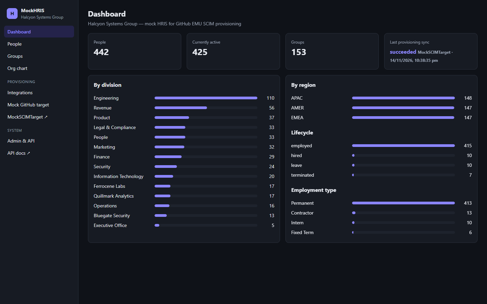

**People** lists everyone, with avatars, title, team, site, level, lifecycle and employment
type. To narrow the list:
- type in **Search** to match name, email, title, team or employee ID
- use the **division**, **region**, **lifecycle** and **employment** filters
- for anything more specific, write a **query** and press **Apply query** (see the
  [query language](query-language.md))

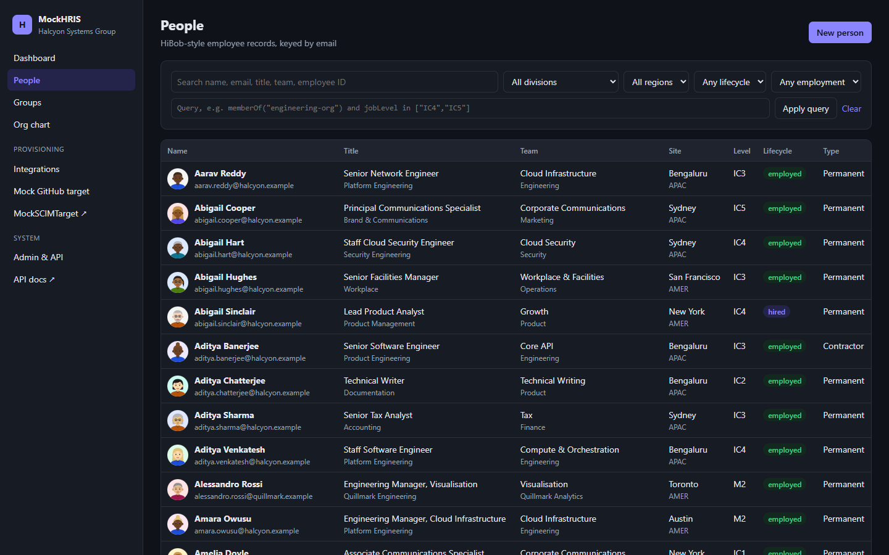

The query below finds senior and principal engineers in EMEA:

```
memberOf("engineering-org") and region == "EMEA" and jobLevel in ["IC4", "IC5"]
```

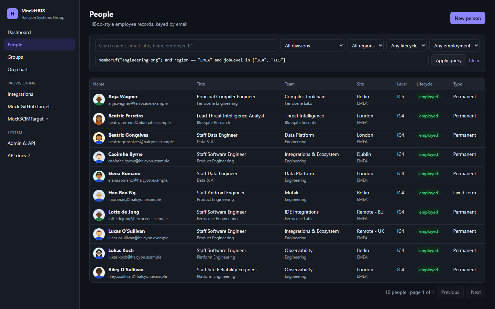

## 3. Managing people

Click a person to open their profile. The **Profile** tab holds the editable HR fields. The
**Derived** panel shows values MockHRIS works out for you: status, region, legal entity,
location, timezone, manager and tenure.

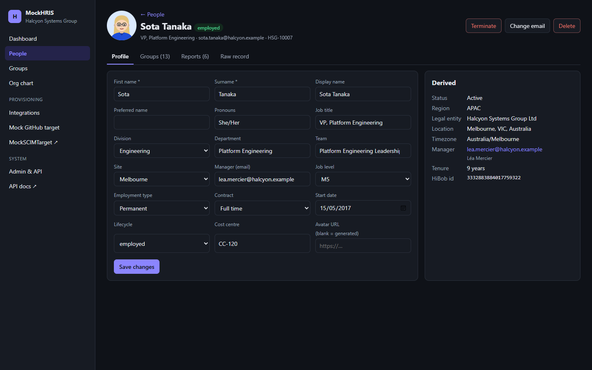

| Task | How |
|---|---|
| Edit someone | Change fields and click **Save changes**. Choosing a **Site** fills in address, region and legal entity. |
| Change their manager | Type the manager's email in **Manager**. MockHRIS rejects reporting cycles. |
| Use a custom photo | Set **Avatar URL**. Leave it blank for the generated portrait. |
| Leaver | **Terminate**, then enter a date and reason. Their status becomes *Inactive*. |
| Rehire | **Rehire** on a terminated person |
| Change email | **Change email**. Group memberships, manager links and provisioning state follow. |
| Delete | **Delete**. This is blocked while they have direct reports, so reassign those first. |
| See group memberships | The **Groups** tab, which shows *static* or *via query* for each |
| Edit anything | The **Raw record** tab holds the full HiBob-style JSON |

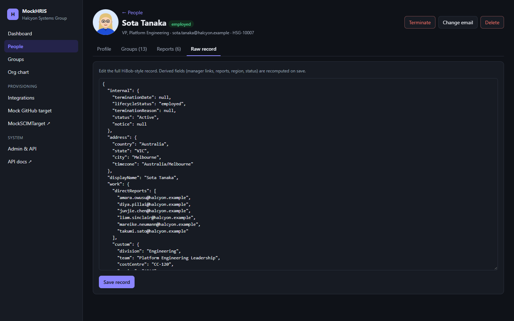

To add someone, go to **People → New person**. Email, first name and surname are required.

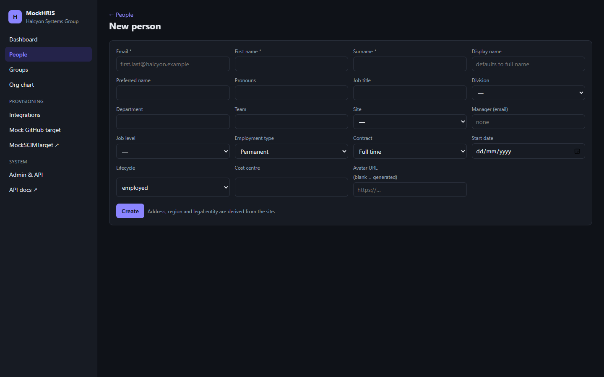

## 4. Groups and dynamic groups

**Groups** lists every group with its type, member count and definition:
- **static** groups list their members
- **dynamic** groups use a query
- **mixed** groups do both

Filter by kind (`div`, `dept`, `team`, `region`, `entity` or other) or by type.

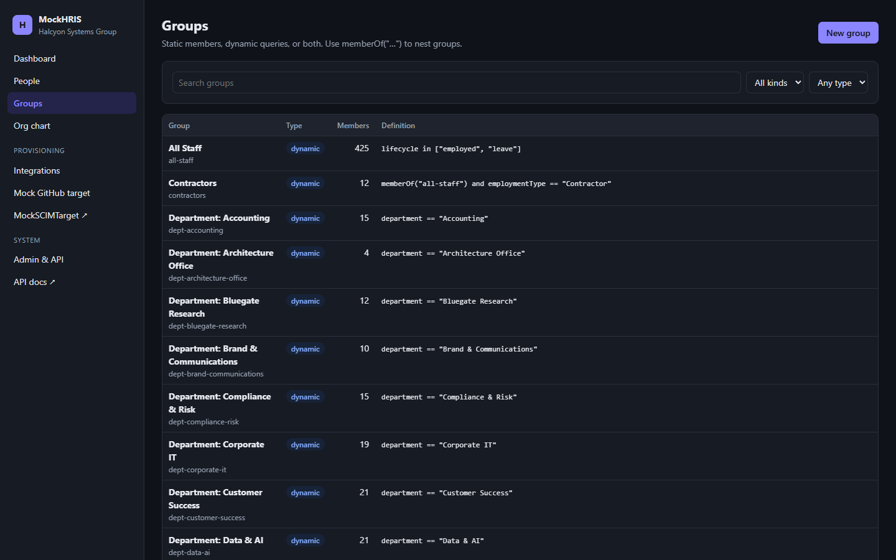

### Create a dynamic group

1. Go to **Groups → New group** and enter a slug **name**, such as `payments-oncall`, and a
   **display name**.
2. Write a **query**. Use **Insert memberOf(…)** to nest another group. Open **Fields &
   operators** to click aliases into the query.
3. Click **Test query** to see how many people match, with a preview list.
4. Optionally add **static members**, one email per line, or with the **Add member** box.
5. Click **Create group**.

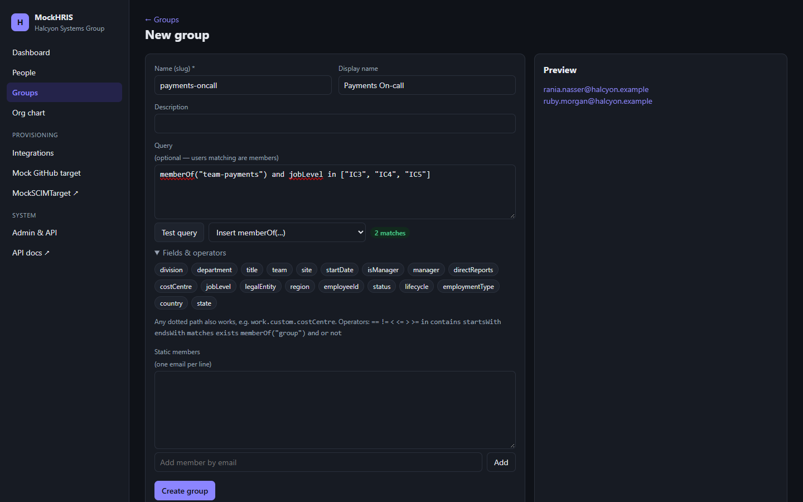

An existing group shows its **resolved members**. People added as static members carry a
*static* badge. The panel also lists the groups this one **includes** through `memberOf`, and
what **uses** it: other groups, or an integration's scope or role rules.

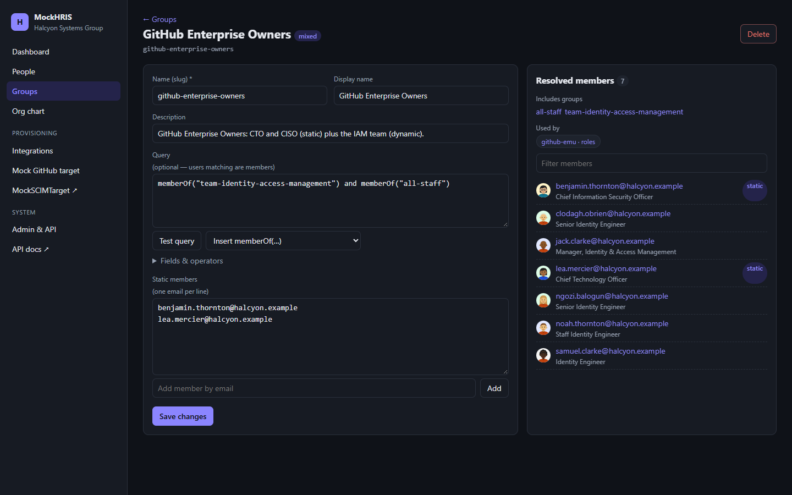

> MockHRIS rejects a group that would create a cycle (`a → b → a`), use an unknown field, or
> reference a missing group. It also refuses to delete a group while something still uses it.

## 5. The org chart

**Org chart** draws the reporting lines. Card colours follow the division.

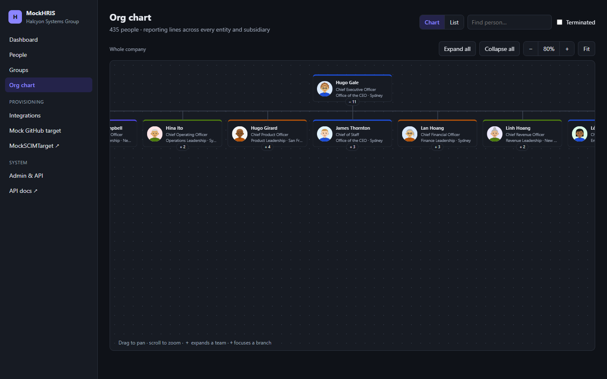

| Control | What it does |
|---|---|
| Drag the background | Pan the chart |
| Scroll | Zoom, centred on the cursor. The **− / % / +** buttons and **Fit** do the same. |
| **+ N** under a card | Expand that person's reports. Individual contributors stack in a column under their manager. |
| **⌖** on a card (hover) | Show only that branch. The breadcrumbs lead back to the whole company. |
| **Find person** | Expand down to someone and highlight them |
| **Terminated** | Include leavers, shown faded |
| **Chart / List** | Switch between the diagram and an indented list |

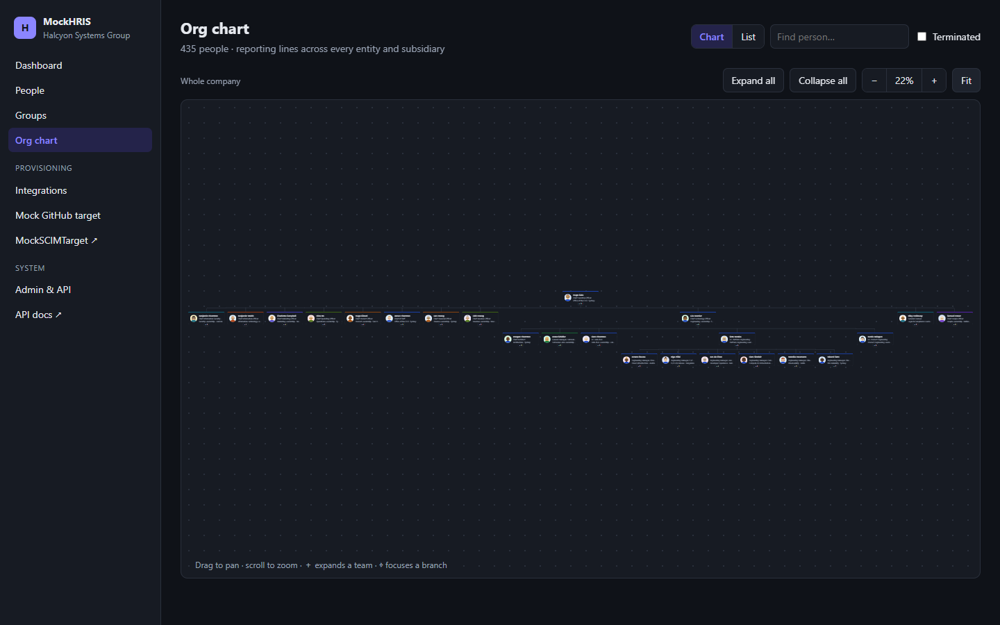

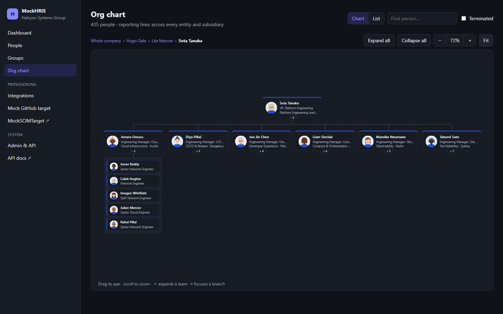

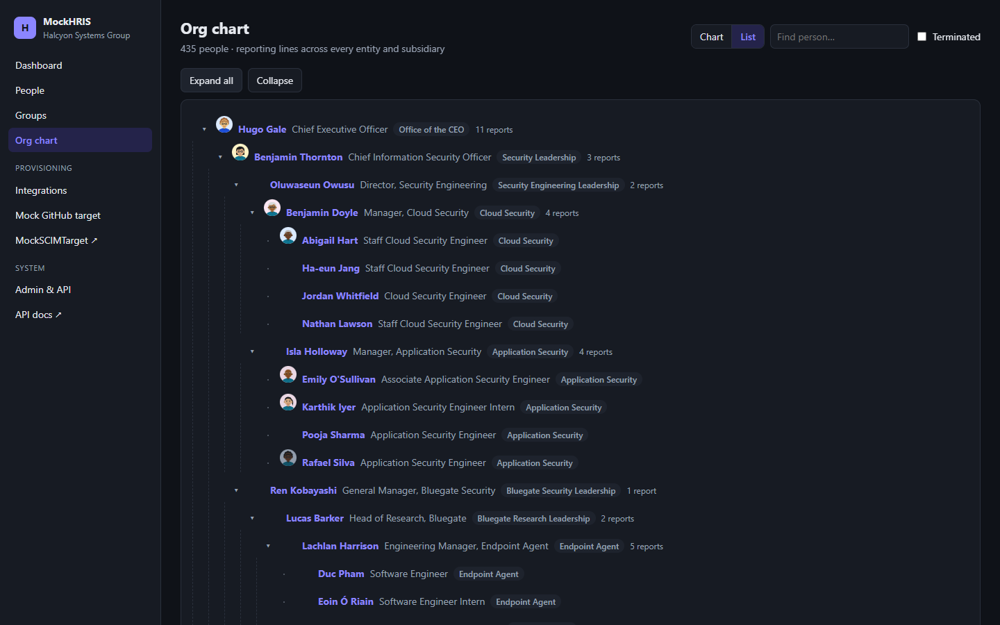

## 6. Setting up a provisioning integration

An integration provisions HR identities to one SCIM 2.0 application. Open **Integrations** to
see them all. **Add integration** starts a new one from a template:

| Template | Use it for |
|---|---|
| **GitHub Enterprise Managed Users** | GitHub EMU on github.com or GHE.com |
| **Generic SCIM 2.0** | Any SCIM 2.0 application, such as scim-target, Slack, Atlassian or Zoom |

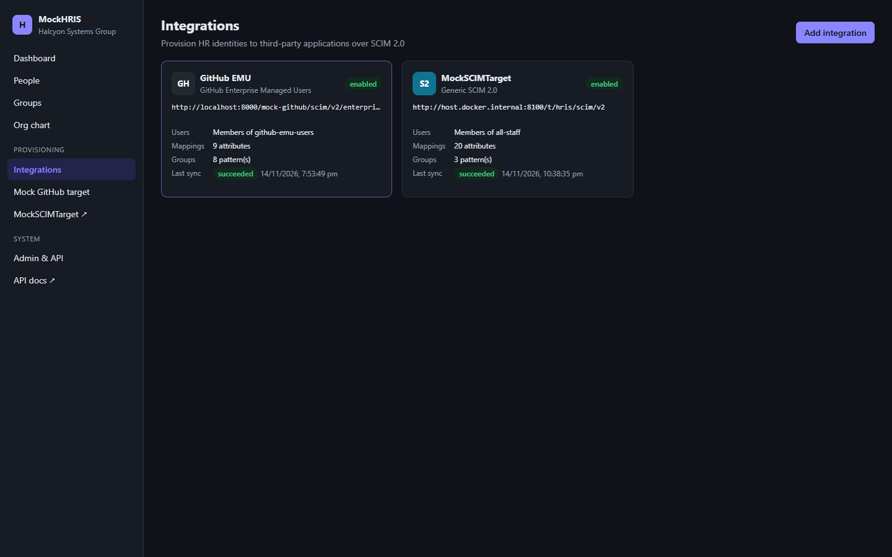

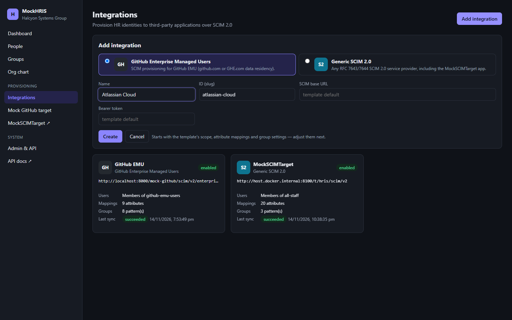

Each integration has tabs, configured left to right. Edits are held as a draft until you click
**Save changes** in the bar at the bottom. **Discard** throws them away.

### Connection

Set the target **SCIM base URL**. Presets fill it in for the built-in mock, GitHub.com, GHE.com
and MockSCIMTarget. Then choose **authentication**: a bearer token, basic auth, or none. You can
also add **custom headers**, change the **timeout** and **request pacing**, and turn off **TLS
verification**.

After saving, click **Test connection**. Stored secrets are shown as *saved* and never sent back
to the browser.

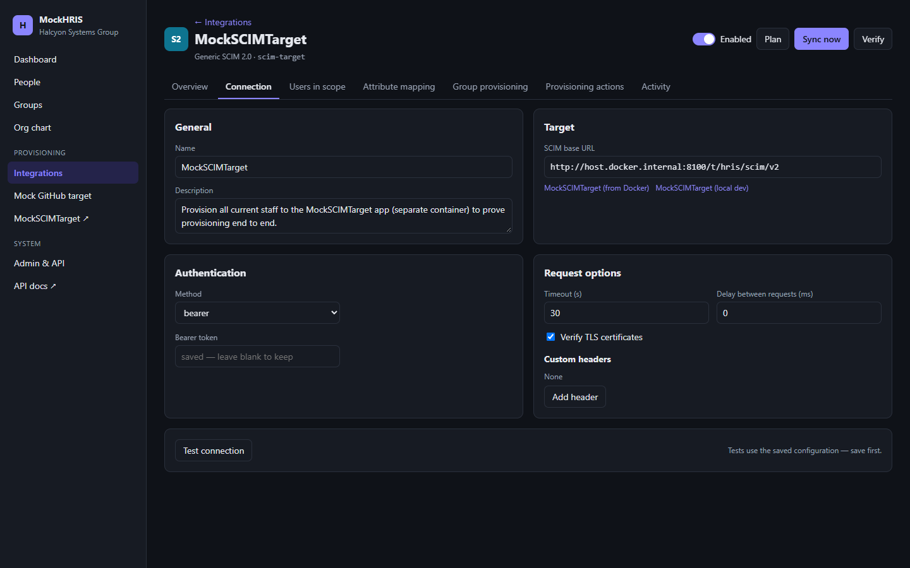

### Users in scope

Choose who gets provisioned:
- the members of a **group**
- the people matching an **attribute filter** (a query)
- **all users**

The preview counts active and inactive people and shows a sample. Only *Active* people are
provisioned. People who become inactive, or fall out of scope, are handled by the
**Provisioning actions** tab.

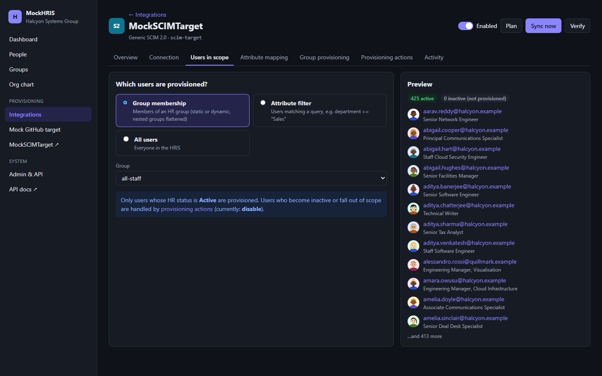

### Attribute mapping

Each row sets one **target SCIM attribute** from an HRIS **source**:

| Column | Meaning |
|---|---|
| **Target attribute** | Any SCIM path, e.g. `userName`, `name.givenName`, `emails[type eq "work"].value`, `roles[].value`, or an enterprise-extension URN. *Required* rows can't be removed. |
| **Source** | A field or alias (`email`, `work.title`), a template (`{firstName}.{surname}`), a literal (`"Halcyon"`), or a computed value: `$active`, `$role`, `$fullName`, `$managerEmail`, `$managerScimId` |
| **Transforms** | Applied in order: `lowercase`, `localPart`, `asciiFold`, `slugify`, … |
| **Default** | Used when the source is empty |
| **Apply on** | `always`, or `create` to keep the first value sent |

The **Preview** panel maps any person **using your unsaved edits**. It shows:
- whether they're in scope and active, their role, and what the next sync would do
- each attribute's raw source value and its final value
- the full SCIM payload

Mistakes, such as an unknown field, a duplicate target or a missing required attribute, show
up immediately.

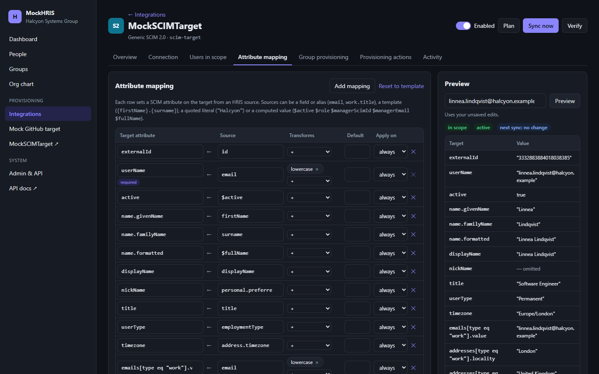

**Role rules**, lower on the same tab, set `$role`. Rules are checked in order and the first
group that contains the person wins; otherwise the default applies. For GitHub EMU the values
are `user`, `enterprise_owner`, `billing_manager` and `guest_collaborator`.

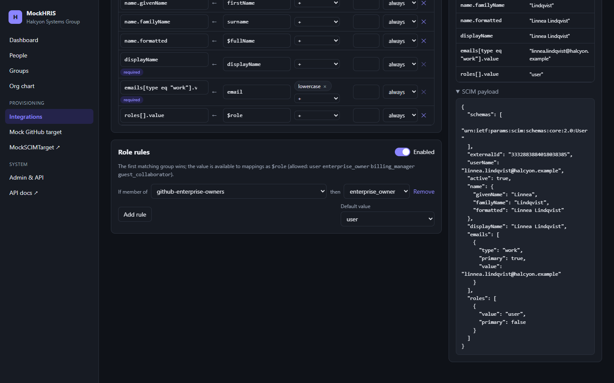

### Group provisioning

Turn **Push groups** on, then list the HR groups to push as **include** and **exclude** glob
patterns. Choose whether the target group name comes from the HR group's display name or its
slug. Members are limited to provisioned, active users. The panel on the right lists exactly
which groups will be pushed, with member counts.

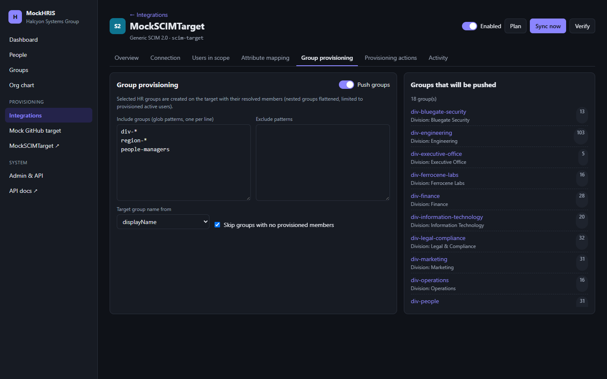

### Provisioning actions

Choose whether creates and updates are allowed. Then choose what happens when someone leaves
scope or becomes inactive:
- **Disable**: suspends them (`active: false`)
- **Delete**: removes them from the target
- **Do nothing**

The danger zone has **Forget provisioning state** and **Delete integration**.

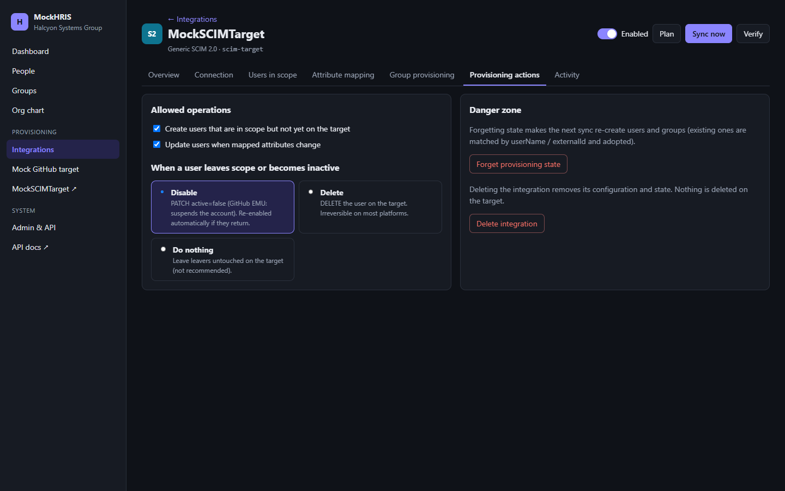

## 7. Plan, sync and verify

The **Overview** tab shows the flow from source, through scope and mapping, to the target. It
also shows key figures and the three actions. The header buttons do the same from any tab.

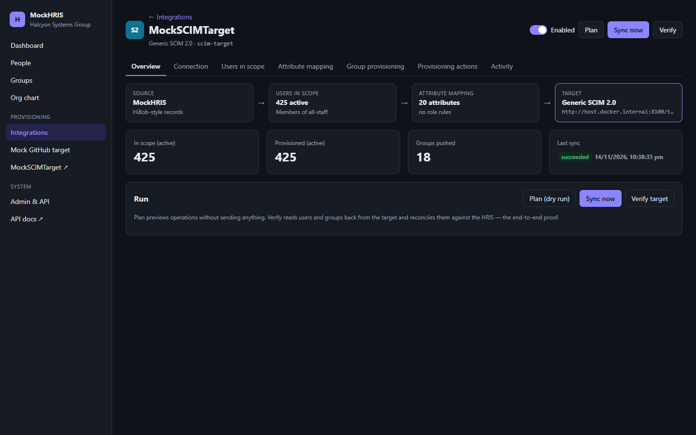

**Plan** is a dry run. It lists every operation a sync would perform, with counts by type. Each
update shows which attributes changed, and each group change shows the members added and
removed.

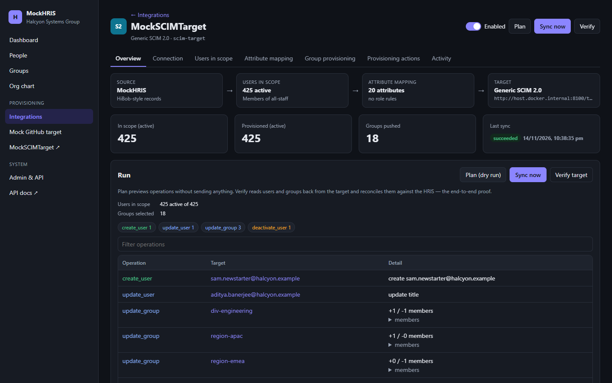

**Sync now** executes the plan in the background, with live progress. Every operation is
listed with its result. Failed operations show their HTTP status and error, and are retried on
the next sync.

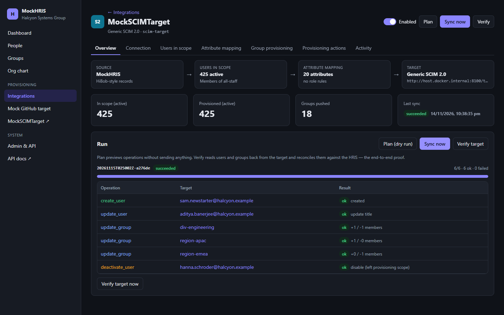

**Verify** reads every user and group back from the target and compares them with the HRIS.
*Verified* means the target matches exactly.

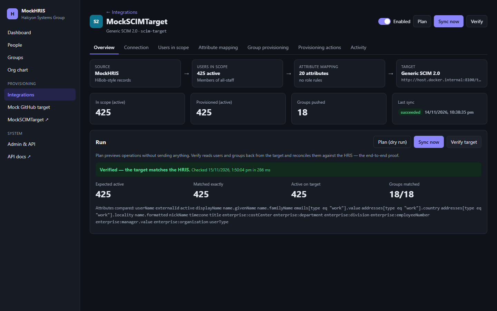

When something differs, Verify says exactly what. In this example, someone edited a user's
title directly on the target. **Full resync** (`full: true` in the API) repairs it.

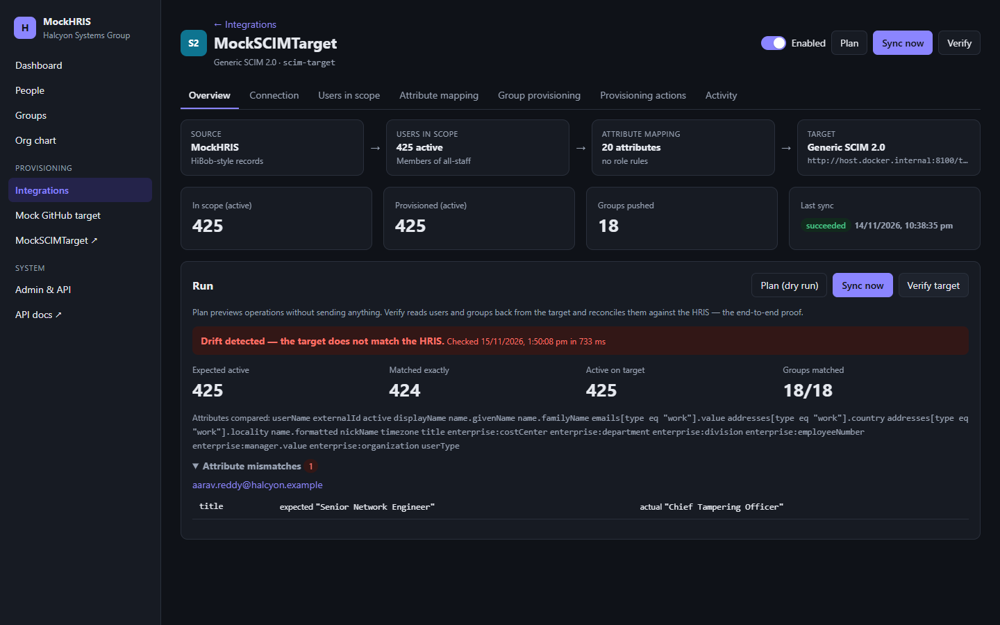

The **Activity** tab keeps the sync history. Click a run to see its operations. The tab also
lists every provisioned identity with its target id and status.

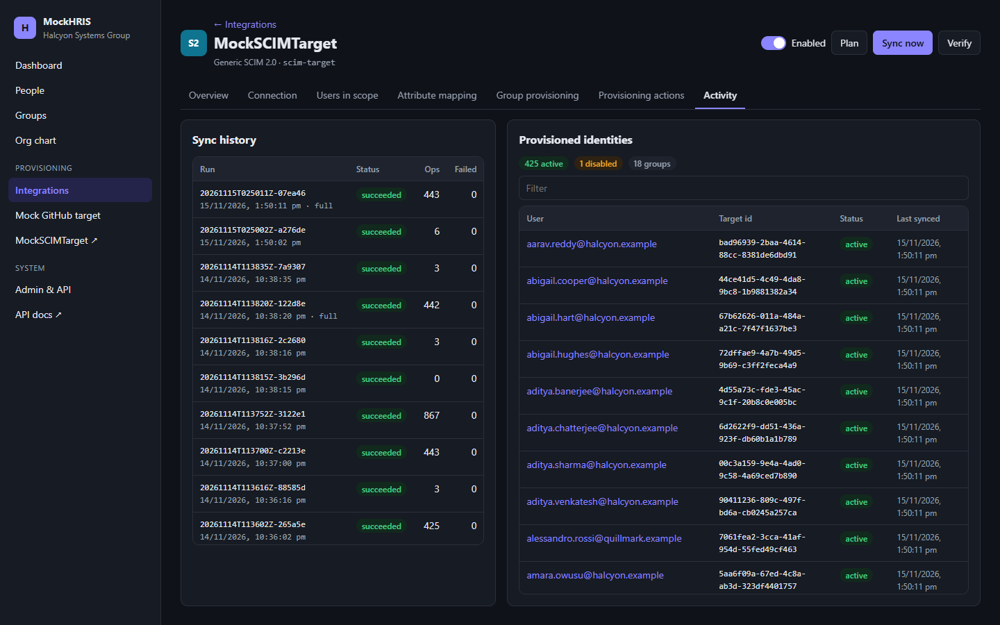

## 8. Joiner, mover and leaver walkthrough

Use the **MockSCIMTarget** integration. Open http://localhost:8100 alongside it to watch each
request arrive.

| Step | In MockHRIS | Then |
|---|---|---|
| Joiner | **People → New person**, lifecycle *employed* | **Verify** reports them *missing*. **Sync now** creates them. |
| Mover | Change their team, site or title | **Verify** shows the changed attributes. **Sync now** updates them and moves their group memberships. |
| Leaver | **Terminate** | **Verify** reports *should be disabled but still active*. **Sync now** suspends them. |
| Rehire | **Rehire** | **Sync now** reactivates them |
| Future starter | New person with lifecycle *hired* | Not provisioned until their lifecycle becomes *employed* |

Each time, finish with **Verify** to confirm the target matches. For an automated version, see
[end-to-end-testing.md](end-to-end-testing.md).

## 9. Rehearsing GitHub EMU

The **GitHub EMU** integration points at the built-in mock. The mock behaves like GitHub:
- it enforces GitHub's required attributes and uniqueness
- group members must already be provisioned
- `active: false` suspends the user
- logins are generated as `handle_shortcode`

**Mock GitHub target** shows what the mock holds.

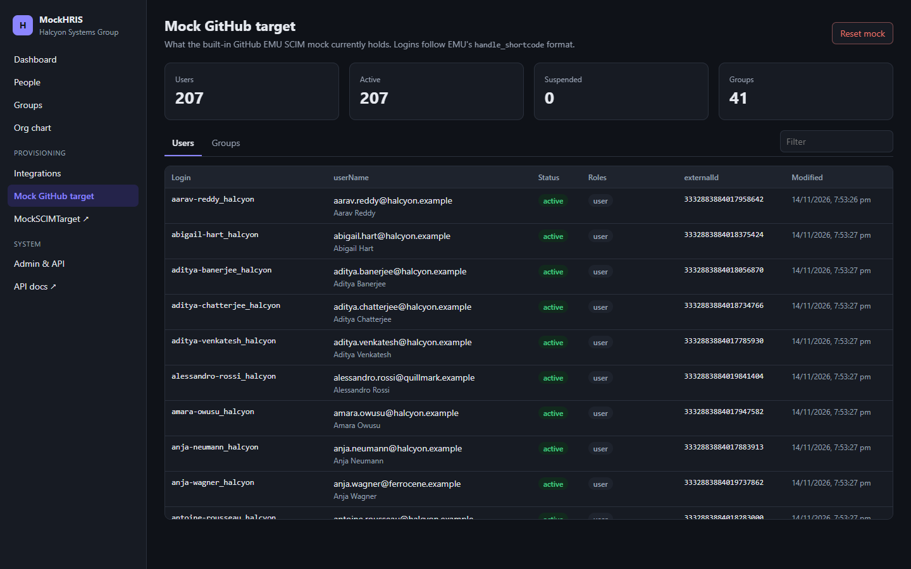

When you're ready to use a real enterprise:
1. On **Connection**, choose the **GitHub.com** or **GHE.com** preset and replace
   `YOUR-ENTERPRISE`.
2. Use the setup user's PAT (classic) with the `scim:enterprise` scope. Preferably supply it as
   the environment variable `INTEGRATION_TOKEN_GITHUB_EMU`, not in the GUI.
3. Click **Test connection**, then **Plan**, and review the plan before you click **Sync now**.
   MockHRIS asks for confirmation before syncing to any target that isn't a built-in mock.

## 10. Admin, backup and integrations with other tools

**Admin & API** offers:
- **Regenerate** the company. Pick a seed for a different, but reproducible, population.
- **Export** or **Import** all people and groups as JSON, replacing or merging.
- **Resolve every group** to check for errors.
- Copy-paste snippets for the REST API and for connecting an MCP client such as Claude.

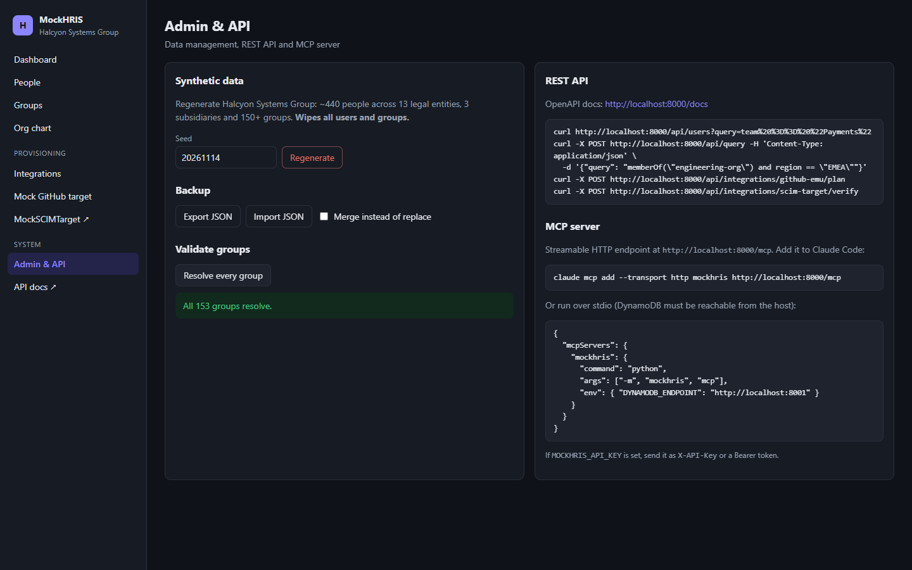

For automation, see the [REST API](api.md) and [MCP server](mcp.md) references.

## 11. Troubleshooting

| Symptom | Cause and fix |
|---|---|
| **Test connection** to MockSCIMTarget fails with `ConnectError` | scim-target isn't running (`docker compose up -d` in scim-target), or you're running MockHRIS outside Docker. In that case use the *local dev* preset (`http://localhost:8100/…`). |
| `HTTP 401` on test or sync | Wrong token. For scim-target the default is `target-token`. For GitHub, the PAT needs `scim:enterprise`. |
| Verify reports mismatches for attributes like `title` or the enterprise fields on GitHub | GitHub, and the built-in mock, don't store those attributes. Remove those mappings for GitHub targets. |
| Verify shows *missing on target* for everyone | The target was wiped. Use **Provisioning actions → Forget provisioning state**, then **Sync now**. |
| A run is `partial` | Look at the failed operations in the run. They're retried on the next sync. |
| Can't delete a group | Something still uses it. The group editor lists it under **Used by**. |
| The GUI asks for an API key | `MOCKHRIS_API_KEY` is set. Enter the same value. It's remembered in your browser. |
